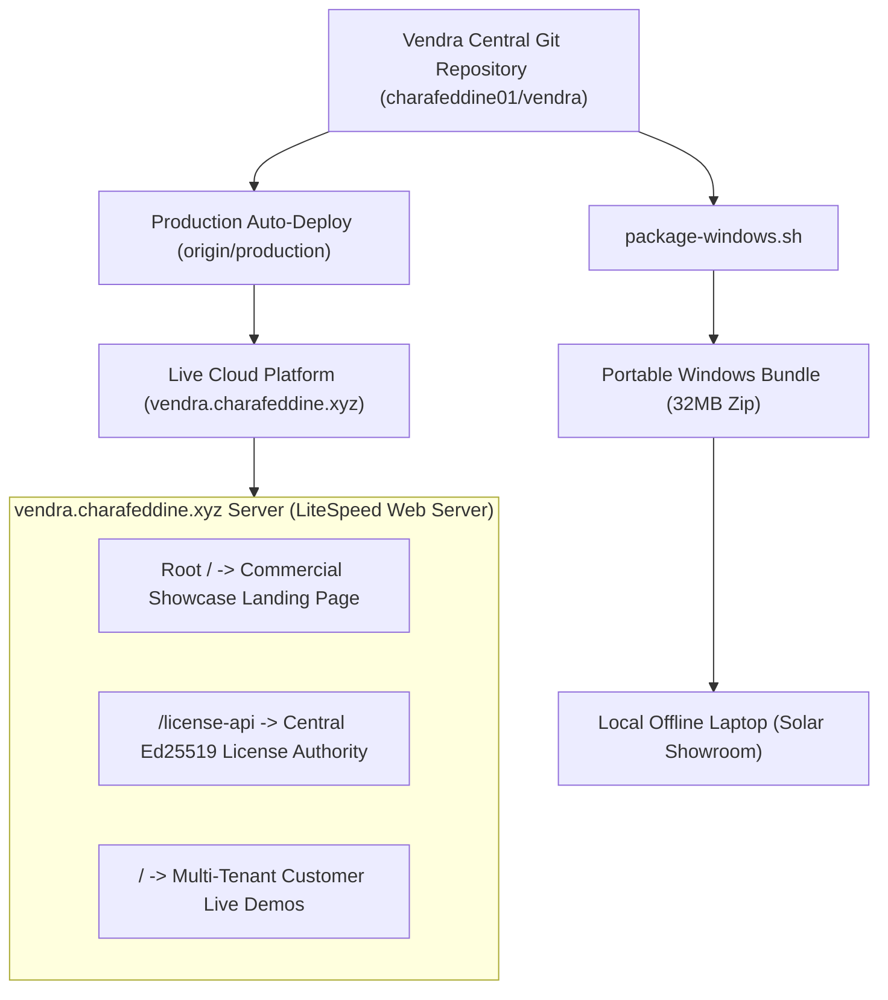
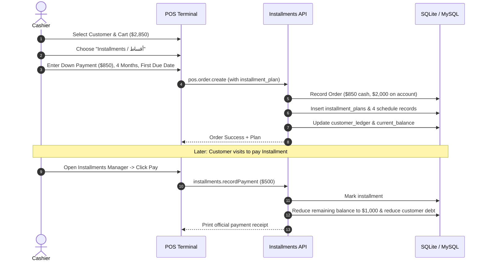

# Vendra Commercial Platform & Universal POS Engine

[](https://vendra.charafeddine.xyz)
[](https://vendra.charafeddine.xyz)
[](https://vendra.charafeddine.xyz/license-api)
[](https://vendra.charafeddine.xyz)

> **Official Live Production Portal:** [https://vendra.charafeddine.xyz](https://vendra.charafeddine.xyz)  
> **Official Contact (WhatsApp):** `+961 70 024 524`  
> **Headquarters:** Baalbeck, Lebanon (بعلبك - لبنان)

---

## 1. Overview & Architecture

**Vendra** is an enterprise-grade commercial point-of-sale and business management platform designed for retail, wholesale, supermarkets, restaurants, and high-ticket specialized showrooms (e.g. Solar Energy systems).

The system operates under a **Single Universal Engine Architecture**: all tenants share a unified codebase, adapting dynamically at runtime via database configuration, business modes, and cryptographically signed license keys.



---

## 2. Live Customer Test Environments (`vendra.charafeddine.xyz/<customer_name>`)

Prospective and active clients can test their tailored showroom live directly in their browser without installing anything:

| URL Route | Purpose | Target Business |
| :--- | :--- | :--- |
| `https://vendra.charafeddine.xyz/` | Commercial Showcase Portal | Public visitors & lead capture |
| `https://vendra.charafeddine.xyz/al-shams` | Solar Showroom Live Demo | Inverters, batteries, serials, installments |
| `https://vendra.charafeddine.xyz/solar` | Solar Energy General Demo | Pre-configured hybrid solar kits & BOM |
| `https://vendra.charafeddine.xyz/<customer_name>` | Dynamic Tenant Demo | Auto-provisions custom branded showroom demo |
| `https://vendra.charafeddine.xyz/license-api` | Asymmetric License Authority | Heartbeat verification & lease tokens |

---

## 3. Solar Energy Showroom & Retail Features

Specially adapted for Solar Energy and technical equipment showrooms:

1. **Serialized Inventory Tracking (`product_serials`):**
   - High-ticket tracking for inverters (Deye, Growatt, Felicity) and lithium batteries (Pylontech, Dyness).
   - Tracks unique unit barcodes, stock state (`AVAILABLE`, `SOLD`), and warranty terms (24 to 120 months).
2. **Bill of Materials (BOM) & Bundled Kits (`product_recipes`):**
   - Sell complete 5kW or 8kW solar systems as single products.
   - Automatically deducts bundled components (inverter, battery, PV panels, DC breakers, surge protectors, and solar cables) from warehouse stock.
3. **Dual Currency Engine (Lebanese Market Standard):**
   - Primary pricing in **USD ($)**, real-time conversion to **LBP (L.L.)** using custom market exchange rates (e.g. `89,500 LBP/USD`).
   - Supports mixed-currency tender and change calculation in both currencies.

---

## 4. Installment Payments System (الأقساط)

High-ticket solar packages ($2,000–$10,000+) frequently require financing plans:



- **Down Payment Deduction:** Immediate cash registration in current shift drawer.
- **Automated Schedule Generator:** Automatically divides remaining balance across weekly or monthly intervals.
- **Overdue Monitoring:** Real-time KPI alerts for overdue payments, payments due this week, and total portfolio volume.
- **Integrated Customer Ledger:** Every installment payment is recorded in the customer's permanent financial statement.

---

## 5. Portable Zero-Dependency Windows Desktop Application

For offline showroom laptops with **zero internet dependence**:

- **Location in repo:** [`dist-windows/`](file:///home/charafeddine/Documents/vendra/dist-windows/)
- **One-Command Build:** Run `./package-windows.sh` to produce a ready-to-distribute **32 MB** zip file:
  `dist-windows/VendraPOS-SolarShowroom-Windows.zip`
- **Zero Prerequisites:** Contains embedded official Windows PHP 8.3 NTS x64 + SQLite + Sodium + cURL + OpenSSL. No XAMPP or MySQL daemons required.
- **Launchers Included:**
  - `Install-Desktop-Shortcut.bat`: 1-click installer that places the desktop shortcut with the official icon.
  - `Launch-VendraPOS.vbs`: Launches the background server invisibly (no black CMD prompt) and opens Microsoft Edge or Chrome in native borderless app window (`--app="http://127.0.0.1:8080"`).
  - `Stop-VendraPOS.bat`: Graceful server shutdown.

---

## 6. Directory Structure

```text
vendra/
├── api/                           # Universal POS PHP backend
│   ├── config.php                 # Environment & database resolver
│   ├── index.php                  # 100% POST Protocol API dispatcher
│   ├── controllers/               # PosController, InstallmentsController, Auth, etc.
│   └── core/                      # Router, Database, LicenseGuard, Auth, Response
├── app.html                       # Vite entry point for POS application
├── database/                      # SQL schemas & specialized seeders
│   ├── schema.sql                 # Complete database schema
│   ├── seed-solar.php             # Solar showroom database generator
│   └── omnipos-solar.sqlite       # Pre-seeded solar database
├── dist/                          # Compiled production assets
├── dist-windows/                  # Portable Windows desktop bundle & packaging tools
├── license-api/                   # Central vendor licensing server
├── public_html/                   # Production document root (mirrored on LiteSpeed)
│   ├── app/                       # Web POS client
│   ├── assets/                    # Compiled CSS & JS bundles
│   ├── api/                       # POS API
│   ├── license-api/               # Licensing API
│   ├── index.html                 # Commercial showcase landing page
│   └── .htaccess                  # Intelligent routing (.htaccess for LiteSpeed)
├── src/                           # Vue / React TypeScript frontend source code
├── build.sh                       # Production compilation & asset sync script
├── deploy-production.sh           # Auto-deploy trigger (main -> production branch)
├── package-windows.sh             # 1-click Windows portable packager
└── router.php                     # Local development built-in server router
```

---

## 7. Developer Quickstart

### Local Development Server
```bash
# Start backend server on port 8000
php -S 0.0.0.0:8000 router.php

# Start Vite dev server on port 3000
npm run dev
```

### Build Production Assets
```bash
# Compile frontend and sync to public_html/
./build.sh
```

### Build Windows Standalone Zip
```bash
# Package 32MB portable Windows distribution
./package-windows.sh
```

### Deploy to Live Production (`vendra.charafeddine.xyz`)
```bash
# Push directly from vendra repository
git add .
git commit -m "feat: your changes"
./deploy-production.sh
```

---

## 8. Credentials & Default Logins

| Role | Username | Default PIN | Default Password |
| :--- | :--- | :--- | :--- |
| **Owner / Admin** | `admin` | `1234` | `admin123` |
| **Sales Manager** | `manager` | `2222` | `manager123` |
| **Cashier** | `cashier` | `0000` | `cashier123` |

---

## 9. Contact & Support

- **Vendor / Author:** Charafeddine
- **WhatsApp:** `+961 70 024 524`
- **Location:** Baalbeck, Lebanon (بعلبك - لبنان)
- **Official Domain:** [https://vendra.charafeddine.xyz](https://vendra.charafeddine.xyz)
